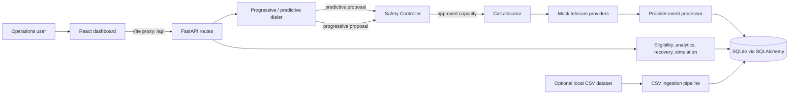
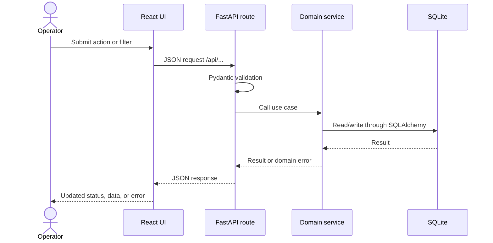
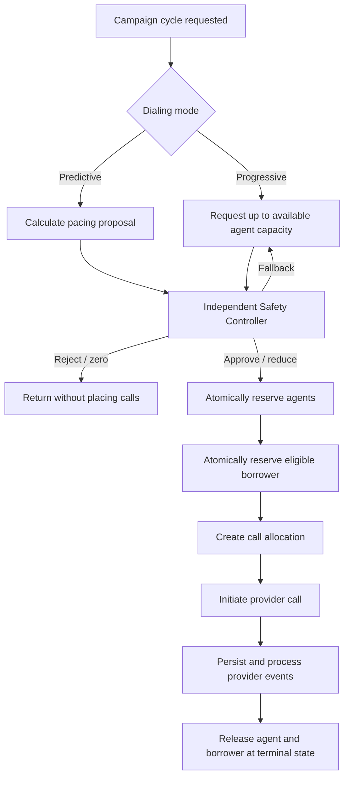

# SmartDialer

SmartDialer is a full-stack hiring assignment that demonstrates a collections
dialing workflow with progressive and predictive pacing, an independent safety
controller, mock telecom providers, and a React operations dashboard. The
backend is built with FastAPI and SQLAlchemy; the frontend is a Vite-powered
React application.

> **Data and privacy:** The assignment's local dataset is synthetic, but its
> borrower tables contain phone and email fields. Raw dataset files and the
> generated SQLite database are intentionally excluded from this repository.
> No live telephony integration is configured; the provider implementations
> simulate call events.

## Problem statement

Outbound dialing systems need to coordinate agent availability, borrower
eligibility, pacing, call state, and provider health. A pacing decision must
not exceed the capacity the system can safely support. SmartDialer models this
workflow and demonstrates how a separate safety check can sit between
predictive pacing and call allocation.

## Key features

- **Progressive dialing:** Proposes work within available-agent capacity and
  reserves agents before allocating calls.
- **Predictive dialing:** Calculates a pacing proposal from campaign and
  historical call metrics, then submits it to the Safety Controller for
  approval before allocation.
- **Safety Controller:** Independently validates proposed calls against
  provider health, concurrency and agent capacity, and borrower uniqueness
  constraints.
- **Call and agent state handling:** Explicit state transitions, reservation
  and release workflows, and provider-event processing.
- **Mock providers:** Provider A and Provider B simulate call lifecycles and
  configurable failure, duplicate-event, and event-order behavior.
- **Recovery and simulation:** Recovery helpers reconcile stale reservations;
  simulation endpoints exercise dialing scenarios.
- **Operations dashboard:** React pages for dashboard metrics, agents,
  borrowers, campaigns, calls, providers, safety, analytics, and simulations.
- **Dataset ingestion:** An optional CSV pipeline normalizes selected fields
  and loads the provided assignment dataset into SQLite.

## Technology stack

| Area | Technologies |
|---|---|
| Backend | Python 3.11+, FastAPI, SQLAlchemy 2, Pydantic, Uvicorn |
| Frontend | React 18, Vite, React Router, Recharts, Axios |
| Storage and ingestion | SQLite (WAL mode), CSV, Python standard library |
| Tests | pytest, pytest-asyncio, HTTPX |

## System architecture



### Backend request flow



### Dialing workflow



### Progressive dialing

`ProgressiveDialerService` checks available agents and campaign-eligible
borrowers, submits the request to the Safety Controller, reserves agents, and
allocates approved calls. The service releases agents it could not use and
processes generated mock-provider events. Each cycle is bounded by the
available agent count and its configured batch size.

### Predictive dialing

`PredictiveDialerService` asks `PredictivePacingEngine` for a proposal based
on available agents and historical call performance. It submits that proposal
to the same Safety Controller before reserving agents or allocating calls.
Depending on the controller decision, the service may proceed with an
approved count, stop, or fall back to progressive dialing. The pacing engine
does not call a provider directly.

### Safety Controller

The Safety Controller is the required validation boundary for both dialing
paths. It evaluates proposed capacity and borrower uniqueness and considers
campaign/system limits and provider health before call allocation. The API
also exposes a safety status endpoint. The implementation is an assignment
prototype, not a certified compliance or production dialing system.

### Dataset integration approach

The ingestion code is in `backend/ingestion/`. It expects the assignment CSV
files under `backend/data/raw/` and writes its database and summary beneath
`backend/data/`. The source dataset and all generated data are excluded from
Git. To run ingestion locally, obtain the synthetic assignment dataset
separately, extract the required CSV files into that directory, then run:

```powershell
python -m backend.ingestion.run_ingestion
```

See [Dataset analysis](docs/dataset_analysis.md) for a non-record-level
description of the data quality cases and [Data setup](backend/data/README.md)
for local placement details. Do not substitute real borrower information.

## Repository structure

```text
.
├── .env.example
├── .gitignore
├── README.md
├── INTERVIEW_PREPARATION.md
├── backend/
│   ├── app/                 # API, models, schemas, providers, services
│   ├── data/                # Local-only runtime data; dataset/database ignored
│   ├── ingestion/           # Optional CSV ingestion
│   ├── tests/               # Backend pytest suite
│   └── requirements.txt
├── docs/
│   ├── dataset_analysis.md
│   └── requirements_checklist.md
└── frontend/
    ├── package.json
    ├── package-lock.json
    ├── vite.config.js
    └── src/
```

## Database design

SQLAlchemy models cover agents, borrowers, accounts, campaigns, daily targeting,
calls and allocations, provider events, simulation runs, and collection-history
records. The local SQLite engine enables WAL, foreign-key checks, and a busy
timeout. Tables are created with SQLAlchemy `create_all` at startup; this
prototype does not yet include schema migrations. Borrower contact fields are
treated as sensitive and generated databases/dataset files are excluded from
Git. Do not load real borrower data into a public or shared environment.

## Installation

Requirements: Python 3.11 or newer, Node.js 22.12 or newer, npm, and Git.

### Backend

From the repository root, create a virtual environment and install dependencies:

```powershell
python -m venv .venv
.\.venv\Scripts\Activate.ps1
python -m pip install -r backend\requirements.txt
```

On macOS/Linux, activate with `source .venv/bin/activate`.

The application uses a local SQLite database by default and creates its data
directory when the backend starts. To override settings, copy `.env.example`
to `.env` in the repository root and edit the supported values.

### Frontend

```powershell
Set-Location frontend
npm ci
```

## Running the application

Open two terminals, both starting at the repository root.

**Backend terminal:**

```powershell
.\.venv\Scripts\Activate.ps1
python -m uvicorn backend.app.main:app --reload --host 127.0.0.1 --port 8000
```

The API is at <http://localhost:8000>, its OpenAPI page at
<http://localhost:8000/docs>, and its health endpoint at
<http://localhost:8000/health>.

**Frontend terminal:**

```powershell
Set-Location frontend
npm run dev
```

Open <http://localhost:5173>. Vite proxies `/api` and `/health` to the backend
on port 8000. Without locally ingested or seeded records, data-backed dashboard
views may be empty; ingestion is optional and requires the separate synthetic
CSV dataset.

## Testing

Run the backend tests from the repository root:

```powershell
.\.venv\Scripts\Activate.ps1
python -m pytest backend\tests -v
```

Build the frontend from its directory:

```powershell
Set-Location frontend
npm ci
npm run build
```

Run the frontend unit tests with:

```powershell
Set-Location frontend
npm test
```

## API endpoint overview

The interactive, authoritative schema is available at `/docs`. The main
endpoints are:

| Method | Path | Purpose |
|---|---|---|
| GET | `/health` | Service health |
| GET | `/api/kpis` | Dashboard summary metrics |
| GET/POST | `/api/agents` and `/api/agents/{agent_id}/status` | List and update agent state |
| POST | `/api/agents/disconnect-batch` | Simulate agent disconnection |
| GET | `/api/borrowers` | List eligible borrower records |
| GET | `/api/campaigns` | List campaigns |
| POST | `/api/campaigns/{campaign_id}/start`, `/pause`, `/mode` | Update campaign operation |
| GET | `/api/calls` | List call records |
| POST | `/api/calls/dial/progressive`, `/api/calls/dial/predictive` | Run one dialing cycle |
| GET/POST | `/api/providers` and `/api/providers/{provider_name}/outage` | Inspect and inject provider outage |
| POST | `/api/providers/{provider_name}/reset-circuit` | Reset provider circuit breaker |
| GET | `/api/safety/status` | Read current safety diagnostics |
| GET/POST | `/api/simulation/scenarios`, `/api/simulation/run` | List and run simulations |
| GET | `/api/simulation/history` | List saved simulation results |
| GET | `/api/analytics/campaigns`, `/api/analytics/vendors`, `/api/analytics/dispositions` | Analytics summaries |

This local assignment prototype does not implement authentication or
authorization. Keep it bound to a trusted local network; do not expose its
control endpoints publicly. CORS is restricted to local Vite origins by
default; set `CORS_ORIGINS` to a comma-separated allowlist when hosting the UI
elsewhere.

## Screenshots

Screenshots are not included yet. Add reviewed, synthetic-data-only captures
here before publishing if visual examples are desired.

## Future improvements

- Add authentication, authorization, and role-based access.
- Move shared provider/circuit-breaker state to a durable store for
  multi-worker deployments.
- Consider PostgreSQL for production-scale concurrent writes.
- Move long-running simulations to a background job system.
- Add monitoring, deployment configuration, and compliance review before any
  real-world use.
- Add authentication/authorization and database migrations before deployment.

## Documentation

- [Interview preparation](INTERVIEW_PREPARATION.md)
- [Dataset analysis](docs/dataset_analysis.md)
- [Requirements checklist](docs/requirements_checklist.md)
- [Local data setup](backend/data/README.md)
